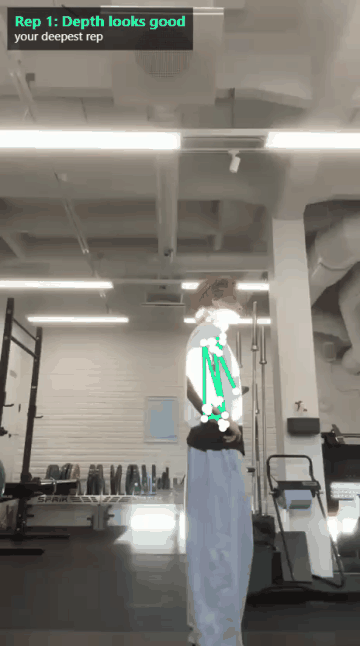
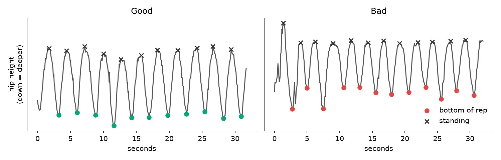
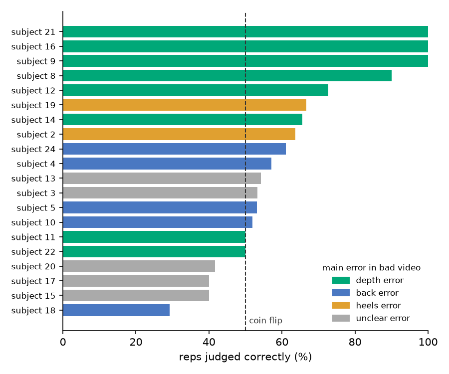
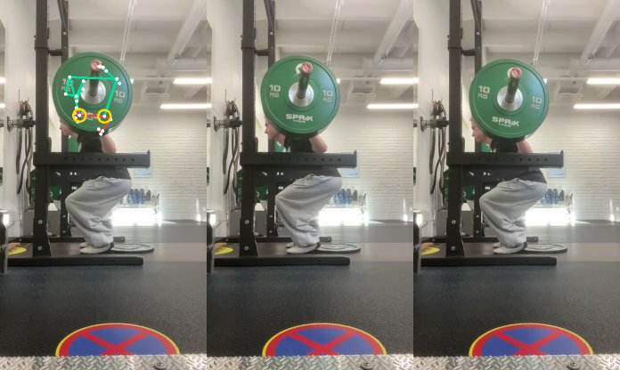

# FormCheck

FormCheck looks at a video of your (or anyones) squats and tells you, rep by rep, whether you went deep enough. It replays the video with a skeleton drawn over you, and you can download that video. 
Everything runs in the browser. The video never leaves your device.

<p align="center">
  
</p>

> Works for **bodyweight squats filmed from the side**. Barbell squats don't work yet (see [Limitations](#limitations)).

## How it works


1. **Pose.** [MediaPipe Pose Landmarker](https://developers.google.com/edge/mediapipe/solutions/vision/pose_landmarker) finds 33 body points in every frame, running as WebAssembly in the browser.
2. **Reps.** The hip goes down and up once per rep, so its height over time is a wave. Each dip is a rep.
3. **Measurements.** At the bottom of each rep the app measures the thigh, knee and hip angles, torso lean, how far the knee goes past the toes, and how long the way down and up took.
4. **Depth.** A small logistic regression model turns those numbers into "deep enough" or "too shallow". It was trained in Python and exported to JSON, so in the browser it's just a few multiplications.



## Building the model

I trained on a public dataset of [squat videos labeled good or bad](https://data.mendeley.com/datasets/kgbb3yn47p/3), using the side-view videos: 25 people, one good and one bad set each.

### Cleaning the data

The data needed more cleaning than I expected:

- **Hard-to-track videos.** Handheld cameras, backlight and privacy blur boxes meant that in the worst video, nobody was detected in 39% of frames. I dropped every video with more than 10% missing frames.
- **Duplicate videos.** I fingerprinted each video by its sequence of thigh angles and found identical footage filed under different names:

| Videos | Problem | Fix |
|---|---|---|
| Subjects 5 and 6 | Same footage under two people | Kept one |
| Subject 23, good vs. bad | Same video, **opposite labels** | Dropped both |
| Subject 15 good vs. subject 26 bad | Same video, **opposite labels** | Dropped both |

The first one is sneaky. The model is always tested on people it hasn't seen, but if one person exists under two names, the model gets tested on footage it already trained on, and the score looks better than it really is.

That left **417 reps from 20 people**.

### Results

Every score is from 5-fold cross-validation **grouped by person**, so the model is always tested on people it never saw. Scores are balanced accuracy, where guessing scores 50%.

| Approach | Score |
|---|---|
| Logistic regression, any error | 64% |
| Random forest, any error | 65%, but swings from 35% to 82% between test groups |
| **Logistic regression, depth errors only** | **85%** |
| Logistic regression, back errors only | 58% |

### What I learned

**"Bad" meant different things for different people.** The first model did great on some people and worse than a coin flip on others. When I looked at who was who, the pattern was clear: it got the people whose bad squats were *shallow* right, and failed on people whose bad squats were bad for other reasons.



So I watched every bad video and labeled its main error myself ([labels/errors.csv](labels/errors.csv)). Training only on depth errors took the score from 64% to **85%**, with the same data and features, just a clearer question.

**Back errors didn't work.** MediaPipe has no spine points, so a rounded back and a straight one look the same from the shoulder-to-hip line.

**Compare a lifter with themselves.** Subject 14's bad reps were clearly shallower than their own good ones (−22° vs. −4° thigh angle), but −22° is normal depth for everyone else. That's why the app also reports each rep's depth relative to your deepest rep.

**Simple beat complex.** With only 20 people, the random forest learned individual quirks. Logistic regression was the more reliable choice.

## The browser app

Plain TypeScript and Vite, no framework. Code is in [app/src](app/src).

- [pose.ts](app/src/pose.ts) plays the video and runs MediaPipe on every frame using `requestVideoFrameCallback`. My first version seeked to each frame instead, which was slow and processed every frame twice.
- [reps.ts](app/src/reps.ts) is a port of the Python rep detection, including SciPy's `find_peaks`. I checked it against Python on the same video: both found the same 10 reps, with thigh angles within a few degrees.
- [model.ts](app/src/model.ts) runs the exported depth model.
- [draw.ts](app/src/draw.ts) and [export.ts](app/src/export.ts) draw the skeleton and record the annotated video with `MediaRecorder`.

## Limitations

- **Bodyweight squats only.** I tried one of my own barbell sets, and from the side the plates cover the hips at the bottom of every rep, which is exactly where depth is measured. MediaPipe lost the person in 35% of frames, and sometimes placed the hips on the plate:



- **Side view only.** If the camera faces the lifter more, the thighs look flatter than they are and depth is misjudged.
- **The data is the biggest bottleneck.** After dropping blurry, shaky and duplicate videos, only 20 people were left, and results vary a lot depending on who's in the test group. The labels are also per video, so a "bad" video can contain good reps. More people, steadier side-on footage and per-rep labels would likely help more than a fancier model.

## Running it

**App**

```bash
cd app
npm install
npm run dev
```

The MediaPipe WebAssembly files and pose model are included in `app/public/`, so nothing is loaded from a CDN.

**Python (data and model)**

```bash
python -m venv .venv
.venv\Scripts\Activate.ps1      # macOS/Linux: source .venv/bin/activate
pip install -r requirements.txt
```

Download `Dataset Exercise-wise.zip` from the [dataset page](https://data.mendeley.com/datasets/kgbb3yn47p/3) into `data/`, and [pose_landmarker_full.task](https://storage.googleapis.com/mediapipe_models/pose_landmarker/pose_landmarker_full/float16/latest/pose_landmarker_full.task) into `models/`. Then:

```bash
python main.py                  # landmarks for all videos (~6 min on CPU)
python features.py              # build and clean the table of reps
python model.py                 # evaluate the models
python export_model.py          # write app/public/depth_model.json
python scripts/make_figures.py  # regenerate the figures in docs/
```

## What's next

- Barbell squats, filmed from a diagonal angle so the plates don't hide the hips.
- A check that warns when the camera isn't side-on.
- A bigger, cleaner dataset with per-rep labels, including my own sets. [Fitness-AQA](https://github.com/ParitoshParmar/Fitness-AQA) has back squats labeled by trainers and looks like a good next step.

## License

The code is under the [MIT License](LICENSE). The dataset keeps its own license (CC BY 4.0), and the videos in `docs/` aren't covered by the code license.

## Credits

Dataset: Sai Prashanth, D., Kamath, P., Bhandary, R., Pai, S. A., PN, P., P, A., Mashetty, A. (2026). *A Multi-View Raw Video Dataset of Seven Fitness Exercises with Good/Bad Form Labels.* Mendeley Data, V3. [doi:10.17632/kgbb3yn47p.3](https://doi.org/10.17632/kgbb3yn47p.3). CC BY 4.0.

Pose estimation: [MediaPipe](https://github.com/google-ai-edge/mediapipe) by Google (Apache 2.0).
